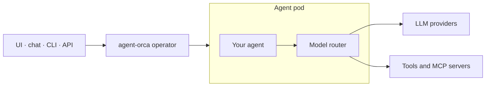

<p align="center">
  
</p>

<h1 align="center">agent-orca</h1>

<p align="center"><b>Run and govern AI agents on Kubernetes.</b></p>

<p align="center">
  <a href="https://github.com/heddles/agent-orca/releases"></a>
  <a href="https://github.com/heddles/agent-orca/actions/workflows/test.yml"></a>
  <a href="https://github.com/heddles/agent-orca/actions/workflows/lint.yml"></a>
  <a href="LICENSE"></a>
</p>

<p align="center">
  <a href="https://docs.agentorca.org">Documentation</a> ·
  <a href="#quick-start">Quick start</a> ·
  <a href="https://docs.agentorca.org/demos">Demos</a> ·
  <a href="ROADMAP.md">Roadmap</a> ·
  <a href="CONTRIBUTING.md">Contributing</a>
</p>

<p align="center">
  
</p>

## What is agent-orca?

agent-orca is a Kubernetes-native platform for AI agents. You declare agents,
models and tools as Kubernetes resources, and agent-orca runs them as one-off
jobs, long-running services or multi-step workflows.

**Our goal:** make running agents as manageable as running any other workload,
so a team can see what each agent did, what it cost and what it was allowed to do.

## Features

- **Declarative agents.** Agents, tools, models and workflows are custom
  resources you can manage with GitOps.
- **Model routing.** Route each call across providers, with fallbacks and
  [spend budgets](https://docs.agentorca.org/run-budgets).
- **Tools and knowledge.** [MCP servers](https://docs.agentorca.org/mcp-access-control),
  per-user OAuth and built-in [retrieval](https://docs.agentorca.org/rag).
- **Guardrails.** Content policies, tool-call approvals and optional
  [sandboxed execution](https://docs.agentorca.org/openshell-sandbox).
- **Multi-tenancy.** [Tenant isolation](https://docs.agentorca.org/tenant-isolation),
  OIDC sign-in and per-tenant limits.
- **Where people work.** A web UI, [chat apps](https://docs.agentorca.org/chat-channels),
  [schedules](https://docs.agentorca.org/schedules), a CLI and HTTP APIs.

## How it works



The operator turns each run into a pod. The model router beside your agent
handles model choice, tool calls, spend and checkpoints. See the
[architecture guide](https://docs.agentorca.org/architecture).

## Quick start

You need Docker, [Git LFS](https://git-lfs.com), [kind](https://kind.sigs.k8s.io),
[Skaffold](https://skaffold.dev), Helm, `kubectl` and an API key for a model
provider.

```bash
git clone https://github.com/heddles/agent-orca.git && cd agent-orca
export ANTHROPIC_API_KEY=sk-ant-...   # or OPENAI_API_KEY / GOOGLE_API_KEY
kind create cluster --name agent-orca-dev
kubectl config use-context kind-agent-orca-dev   # skaffold deploys to the current context
skaffold dev -p dev
```

When Skaffold reports `Watching for changes`, create your first agent in a second
terminal:

```bash
kubectl --context kind-agent-orca-dev apply -f config/samples/quickstart.yaml
```

Open <http://localhost:8080> and chat with the `quickstart` agent. To install the
Helm chart on your own cluster instead, see the
[installation guide](https://docs.agentorca.org/installation).

## Project status

agent-orca is under active development. It is pre-1.0 and its resources are
`v1alpha1`, so releases can include breaking changes. Check the
[changelog](CHANGELOG.md) and [known issues](https://docs.agentorca.org/KNOWN_ISSUES)
before upgrading.

## Community and contributing

- Report bugs and request features in [issues](https://github.com/heddles/agent-orca/issues).
- Read [CONTRIBUTING.md](CONTRIBUTING.md) and the
  [development guide](https://docs.agentorca.org/development) to contribute.
- Everyone taking part follows the [Code of Conduct](CODE_OF_CONDUCT.md).
- Report vulnerabilities privately, as described in [SECURITY.md](SECURITY.md).

## License

[Apache 2.0](LICENSE)

---

If agent-orca is useful to you, you can [buy me a coffee](https://buymeacoffee.com/mfish551mfg).
