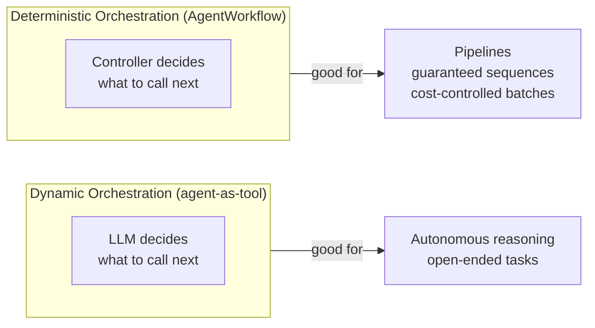
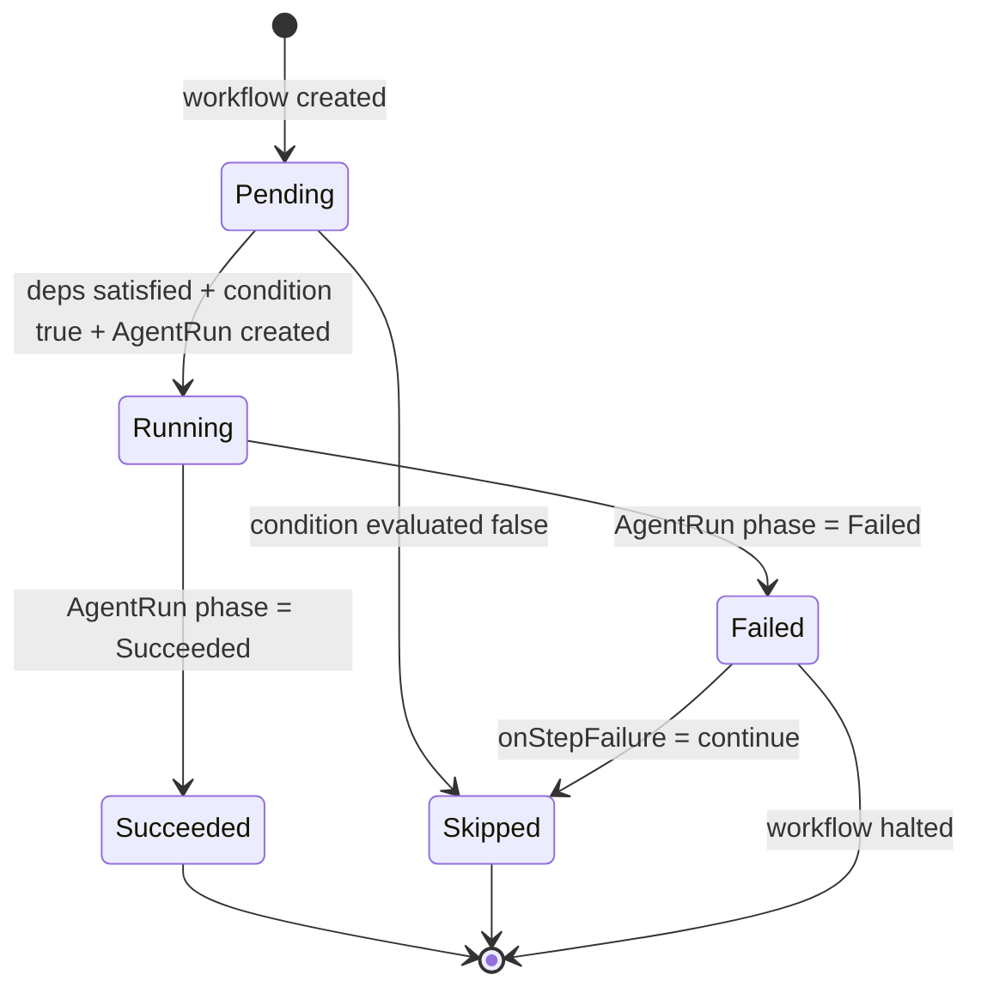
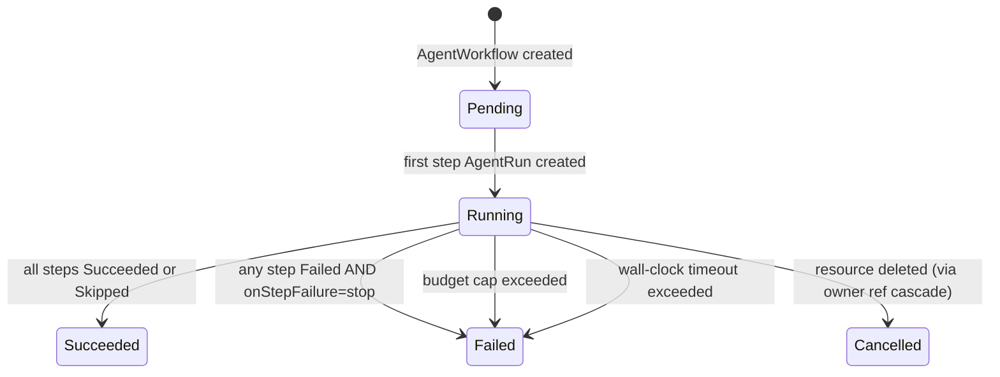

# AgentWorkflow

## What it is

`AgentWorkflow` is a declarative DAG (directed acyclic graph) of agent steps. The operator controller sequences steps, threads outputs between them, and enforces budget caps — without requiring the LLM to coordinate execution.

It is the **deterministic** complement to the **dynamic** agent-as-tool pattern:



| | Agent-as-tool | AgentWorkflow |
|---|---|---|
| Who decides sequencing? | The LLM at runtime | You, declaratively |
| Deterministic? | No | Yes — controller enforced |
| Observable in K8s API? | Label scan only | Full phase/step status |
| Atomic cancellation? | Delete each run manually | `kubectl delete agentworkflow` cascades |
| Budget scope? | Per-run only | Across entire workflow |
| Context threading? | You prompt the LLM | Controller wires output → input |

---

## Schema reference

```yaml
apiVersion: agentorca.agentorca.io/v1alpha1
kind: AgentWorkflow
metadata:
  name: my-workflow
spec:
  # mode: workflow (default) runs. mode: template is a definition that is validated
  # and never run; see "Templates and instances" below.
  mode: workflow
  # parameters (templates only): typed inputs, used as {{params.<name>}} in step inputs.
  # fromTemplate: create this workflow from a template; the controller fills in steps.
  #   fromTemplate: {name: <template>, parameters: {<name>: "<value>"}}

  # sandbox is optional. When set, agent and container steps share this governed
  # OpenShell checkout unless a step selects sandbox: fresh. See "Workflow-owned
  # sandboxes" below. Without it, agents and containers run as before.
  sandbox:
    image: ghcr.io/heddles/agent-orca/dev-sandbox:latest
    classRef: factory-writer         # optional cluster-scoped SandboxClass
    repo: heddles/agent-orca         # GitHub owner/name
    ref: main                        # optional branch, tag or commit; empty = remote HEAD
    branch: factory/ticket-42        # optional local work branch; empty = detached HEAD

  # steps defines the DAG. Steps with no dependsOn start immediately.
  # Required unless fromTemplate is set.
  steps:
    - name: string                    # unique within this workflow, lowercase alphanumeric + hyphens
      type: agent                     # agent (default) | container | approval; see "Step types"
      sandbox: shared                 # shared (default) | fresh; agent/container steps only
      agentRef: string                # agent steps: name of the Agent CRD to run
      input: string                   # agent steps: task string; supports {{steps.<name>.output}}
      dependsOn: []string             # step names that must complete first
      condition: string               # CEL expression; step is Skipped if false
      timeout: duration               # overrides workflow timeout for this step
      callbacks:
        onComplete: string            # URL POSTed on step success
        onFailed: string              # URL POSTed on step failure

  # budgetCap limits total USD across all steps combined.
  budgetCap:
    total: "2.00"

  # timeout is the wall-clock limit for the entire workflow.
  timeout: 30m

  # onStepFailure: "stop" (default) or "continue"
  # stop:     mark workflow Failed, do not start new steps
  # continue: mark failed step Skipped, continue with dependents
  onStepFailure: stop
```

### Template variables

Within a step's `input` field you can reference outputs from predecessor steps:

| Variable | Resolves to |
|---|---|
| `{{steps.<name>.output}}` | The `Output` field of the named step's AgentRun (truncated to 10 KB) |

Example:
```yaml
- name: summarize
  agentRef: writer-agent
  dependsOn: [analyze]
  input: "Write an executive summary of this analysis: {{steps.analyze.output}}"
```

### CEL conditions

The `condition` field accepts a subset of CEL expressions. The `steps` variable is a map of step name → `{phase, output}`.

Supported form: `steps["<name>"].phase == "<phase>"` or `steps["<name>"].output == "<value>"`

```yaml
condition: 'steps["gather"].phase == "Succeeded"'
```

If the expression evaluates to `false`, the step is marked `Skipped` rather than started. Full CEL library support can be wired in without changing call sites.

---

## Step phase lifecycle



---

## Workflow phase lifecycle



A workflow with `spec.mode: template` is a definition and never runs: its phase is `Template`
(see [Templates](#templates-and-instances)).

---

## What the controller creates

For each step, the controller creates one `AgentRun` with:
- Name: `<workflow-name>-<step-name>` (deterministic, idempotent on re-reconcile)
- Owner reference to the `AgentWorkflow` (so `kubectl delete agentworkflow` cascades)
- Labels:
  ```
  agentorca.io/workflow: <workflow-name>
  agentorca.io/workflow-step: <step-name>
  ```

The controller polls step AgentRuns every 10 seconds (no watch — polling keeps the controller simple).

---

## Step types

A step is one of three types. Agent steps are what the rest of this page describes; the other two
make a workflow deterministic where it needs to be.

| Type | Does | Output | Fails when |
|---|---|---|---|
| `agent` (default) | Runs an Agent | The agent's answer | The run fails |
| `container` | Runs one container to completion in a pod or workflow sandbox | The last 10 KB of its output | It exits non-zero, times out, or cannot start |
| `approval` | Waits for a person to approve or reject | `approved by <who>: <reason>` | Rejected, or not decided in time |

All three take `dependsOn`, `condition` and `timeout`, and respect `onStepFailure`.

### Container steps

For work whose result must not depend on a model: run the tests, build the artifact, lint, check
a signature.

```yaml
- name: test
  type: container
  dependsOn: [build]
  container:
    image: ghcr.io/heddles/agent-orca/dev-sandbox:latest
    command: [/usr/local/bin/run-tests]
    env:
      - {name: PLAN, value: "{{steps.build.output}}"}   # data goes in env, not in command or args
    resources: {limits: {cpu: "2", memory: 2Gi}}
```

The pod is deliberately boxed in:

- **No network**, enforced by a deny-all NetworkPolicy for the workflow's step pods. This needs a
  CNI that enforces NetworkPolicy (k3s does), and the CNI programs the rules a moment *after* a
  pod starts: on k3s with flannel the first connection attempt at the instant of start succeeded
  and every attempt from about two seconds on was blocked. So treat it as "no network after the
  first couple of seconds", and run only images you trust (see `ALLOWED_REGISTRIES` below). A job
  that must download packages, or run code you do not trust, belongs in a governed sandbox.
- No service account token, so it cannot call the Kubernetes API; service links off.
- Runs as a non-root user (65532 unless `runAsUser` is set; root is rejected), read-only root
  filesystem, all capabilities dropped, no privilege escalation, the runtime-default seccomp profile.
  `/tmp` and `/work` (the working directory) are writable scratch space and are discarded with the pod.
- CPU and memory limits (1 CPU and 512Mi unless `resources` says otherwise) and a time limit: the
  step's `timeout`, else what is left of the workflow's, else 30 minutes.
- The image must be allowed by the operator's `ALLOWED_REGISTRIES`, if set; otherwise the step fails
  without starting a pod.

The step succeeds on exit code 0. Its output is the tail of what the container printed, capped at
10 KB. When it fails, the reason carries the exit code (and `OOMKilled`, or "timed out") and a
snippet of the output. A pod that cannot start its image for two minutes (a bad tag, no pull access)
fails with the registry's reason rather than waiting forever. The pod is deleted once its output is
captured.

`{{steps.x.output}}` is available in `env` values only. Command and args are fixed, so a step's
output (which may be model text) cannot become shell code.

### Workflow-owned sandboxes

Set `spec.sandbox` when the steps belong to one work item and need a shared, governed checkout.
Agent and container steps use that sandbox by default; `sandbox: fresh` gives a step a dedicated
sandbox from exactly the same commit. Approval steps do not need a sandbox.

```yaml
spec:
  sandbox:
    image: ghcr.io/heddles/agent-orca/dev-sandbox:latest
    classRef: factory-writer
    repo: heddles/agent-orca
    ref: main
    branch: factory/ticket-42
  steps:
    - name: implement
      agentRef: coder
      input: Fix the failing tests on the current branch.

    - name: test
      type: container
      dependsOn: [implement]
      container:
        # A shared container must name the same image as spec.sandbox.
        image: ghcr.io/heddles/agent-orca/dev-sandbox:latest
        command: [make, test]

    - name: verify
      agentRef: verifier
      sandbox: fresh
      dependsOn: [test]
      input: Independently verify the change and its evidence.
```

The controller creates an idle sandbox, applies the workflow `SandboxClass`, and checks out
`repo` at `ref` into `/sandbox/repo`. It records the gateway name and ID, phase, and resolved
commit in `status.sandbox` (`name`, `id`, `phase`, `checkoutSHA`). A fresh step records the same
fields under its step status. The exact shared `checkoutSHA` is the input to every fresh checkout.

Execution is restart-safe: the checkout and every step are **detached jobs inside the sandbox**, with
their scripts, PIDs, output, and exit codes in sandbox files. The operator starts and polls them with
short `Exec` calls. It does not hold an hour-long stream open, so a gateway or operator restart does
not lose the job. A gateway outage is retried; a deleted sandbox or lost job fails rather than
silently rerunning non-idempotent work. Workflow deletion and terminal cleanup remove sandboxes and
credential providers through a finalizer.

Each agent step still has its own `AgentRun`, router URL, router credential, budget, safeguards,
and trace. The shared policy includes every declared agent's router and the union of its class,
inline egress, filesystem, and tools; roles therefore share the merged egress for the sandbox's
lifetime. A workflow-prefixed router rule also covers clarification continuations, while each
router's Kubernetes `NetworkPolicy` admits only the workflow sandbox's supervisor.

Constraints and defaults:

- Every shared Agent must use `spec.sandbox.image` and have a sandbox-compatible split-pod
  configuration and explicit `runtime.command`. A fresh Agent uses its own image and classes.
- A shared container's `container.image` must equal `spec.sandbox.image`; a fresh container may use
  another image. Sandbox jobs need an explicit `container.command` because `Exec` does not invoke
  the image entrypoint. `container.resources` and `runAsUser` remain pod-only; use a `SandboxClass`
  for sandbox resources and placement.
- Dynamic shared agents must be named in `adaptivePolicy.allowedAgentRefs`, so their policies can
  be merged before sandbox creation. An undeclared dynamic agent fails before it starts.
- `repo` is a GitHub `owner/name` repository. With the operator's GitHub App, checkout uses a
  short-lived, repository-scoped, credential-bound provider refreshed before expiry. Without it,
  public clone still works and prompts are disabled. `ref` defaults to the remote HEAD; `branch`
  is optional and creates a local work branch.
- A fresh sandbox is deleted after its step's output is captured. A clarification chain keeps it
  until the final continuation completes, preserving uncommitted work. The shared sandbox lives
  until workflow cleanup.
- Templates carry `sandbox` to instances unless the instance overrides the whole block. Template
  parameters are not substituted into sandbox fields.

Workflows without `spec.sandbox` keep the behavior described above: agent steps create their normal
AgentRuns, and container steps use hardened pods.

### Approval steps

A human gate in the middle of a pipeline: before the deploy, before the merge, before the next
expensive stage.

```yaml
- name: gate
  type: approval
  dependsOn: [test]
  approval:
    message: |
      Tests finished:
      {{steps.test.output}}
      Deploy to production?
    approverGroups: [release-managers]   # empty: anyone with access to the namespace
    timeout: 4h                          # default 24h
```

The request appears in the **Approvals** tab with the message (so the approver sees the evidence,
not just a question), triggers the webhook notification if one is configured, and the step shows
`WaitingForApproval`. Approve and the workflow continues; reject, or let the timeout pass, and the
step fails (so the workflow stops, unless `onStepFailure: continue`). The decision and who made it
are recorded in PostgreSQL. If the workflow ends for another reason while the gate is open, the
request is withdrawn so no one is asked about something that no longer matters.

Approval steps need the PostgreSQL store; without it they fail at once with that reason rather than
waiting for a decision that can never be made. Deleting a workflow does not withdraw its pending
request; it expires at its timeout.

A step that is waiting does not hold up the others: parallel branches keep running, and steps whose
dependencies are met start, while a gate waits.

## Templates and instances

A workflow with `spec.mode: template` is a **definition**: the controller validates it and never
runs it. Other workflows are created from it by name, with typed parameters, so a pipeline is
written once and started many times (once per ticket, per device, per patient study).

```yaml
apiVersion: agentorca.agentorca.io/v1alpha1
kind: AgentWorkflow
metadata: {name: ticket-to-pr, namespace: team-a}
spec:
  mode: template
  parameters:
    - {name: repo, required: true, pattern: "[a-z0-9-]+/[a-z0-9-]+"}
    - {name: title, required: true, maxLength: 200}
    - {name: priority, type: integer, default: "3"}
    - {name: env, enum: [staging, prod], default: staging}
  timeout: 2h
  budgetCap: {total: "5.00"}
  steps:
    - name: plan
      agentRef: planner
      input: "Plan this change to {{params.repo}} (priority {{params.priority}}): {{params.title}}"
    - name: build
      agentRef: implementer
      dependsOn: [plan]
      input: "Implement this plan: {{steps.plan.output}}"
---
apiVersion: agentorca.agentorca.io/v1alpha1
kind: AgentWorkflow
metadata: {name: ticket-42, namespace: team-a}
spec:
  fromTemplate:
    name: ticket-to-pr
    parameters: {repo: heddles/agent-orca, title: "Add a --version flag"}
  budgetCap: {total: "1.00"}   # optional: overrides the template's
```

A full example is `config/samples/workflow-template.yaml`.

**Parameters** are `string` (the default), `integer` or `boolean`, and can be `required`, have a
`default` and an `enum`, and (strings) a `pattern` that must match the whole value and a
`maxLength` (default 8192 bytes). They are given as strings (`"42"`, `"true"`).

**Creating an instance.** On its first reconcile the controller reads the template, checks the
parameters, and fills in the instance's `steps` with `{{params.x}}` substituted. Anything the
instance sets itself (`description`, `timeout`, `budgetCap`, `onStepFailure`, `adaptivePolicy`)
wins over the template's. `status.template` records which template and generation it was built
from, and the `TemplateResolved` condition reports the result. An instance created before its
template exists waits for it; wrong or missing parameters fail it with the reason.

**What a template is checked for** (the `Valid` condition on the template lists every problem):
unique step names, dependencies that exist and form no cycle, `{{steps.x.output}}` only from
steps the step depends on (otherwise it would always be empty), every `{{params.x}}` declared,
parameter defaults that satisfy their own type, enum and pattern, and conditions the controller can
evaluate. A workflow that is not a template gets the structural checks (names, dependencies,
cycles) before it starts, so a cycle fails with a message instead of waiting forever.

**Parameters are text from outside, so they go only where text belongs.** They can fill an agent
step's input, a container step's `env` values and an approval message. They cannot be used in
`agentRef`, a step name, `dependsOn`, a `condition`, a container's `image`, `command` or `args`, or
`approverGroups`: a ticket title must not be able to choose which agent or image runs, what a job
executes, who approves, or inject into an expression, and the template is rejected if it tries. A
value that contains `{{` has the braces separated by an invisible character, so it cannot pull
another step's output into an input.

---

## Examples

### Linear chain: research → analyze → summarize

```yaml
apiVersion: agentorca.agentorca.io/v1alpha1
kind: AgentWorkflow
metadata:
  name: research-pipeline
spec:
  budgetCap:
    total: "1.50"
  timeout: 20m
  steps:
    - name: research
      agentRef: researcher-agent
      input: "Research the latest developments in quantum computing in 2026."

    - name: analyze
      agentRef: analyst-agent
      dependsOn: [research]
      input: |
        Analyze the following research findings and identify the top 3 implications
        for enterprise software companies:

        {{steps.research.output}}

    - name: summarize
      agentRef: writer-agent
      dependsOn: [analyze]
      input: |
        Write a 200-word executive summary based on this analysis:

        {{steps.analyze.output}}
```

### Fan-out with conditional merge

```yaml
apiVersion: agentorca.agentorca.io/v1alpha1
kind: AgentWorkflow
metadata:
  name: parallel-review
spec:
  onStepFailure: continue
  steps:
    - name: gather
      agentRef: data-agent
      input: "Gather Q1 2026 sales data for regions EMEA and APAC."

    - name: emea-analysis
      agentRef: analyst-agent
      dependsOn: [gather]
      input: "Analyze EMEA region from: {{steps.gather.output}}"

    - name: apac-analysis
      agentRef: analyst-agent
      dependsOn: [gather]
      input: "Analyze APAC region from: {{steps.gather.output}}"

    - name: merge
      agentRef: writer-agent
      dependsOn: [emea-analysis, apac-analysis]
      condition: 'steps["emea-analysis"].phase == "Succeeded"'
      input: |
        Combine these regional analyses into a unified report:

        EMEA: {{steps.emea-analysis.output}}
        APAC: {{steps.apac-analysis.output}}
```

### Error handling with `onStepFailure: continue`

```yaml
spec:
  onStepFailure: continue   # failed steps become Skipped; subsequent steps may still run
  steps:
    - name: optional-enrichment
      agentRef: enrichment-agent
      input: "Enrich the dataset with external signals."

    - name: report
      agentRef: reporter-agent
      dependsOn: [optional-enrichment]
      # runs even if optional-enrichment failed/was skipped
      input: "Generate the report. Enrichment data (if available): {{steps.optional-enrichment.output}}"
```

---

## Observing workflow progress

```bash
# Watch overall phase
kubectl get agentworkflow my-workflow -w

# Inspect step-level status
kubectl get agentworkflow my-workflow -o jsonpath='{.status.steps}' | jq .

# Follow a step's AgentRun directly
kubectl get agentrun my-workflow-research -o wide

# Total spend so far
kubectl get agentworkflow my-workflow -o jsonpath='{.status.totalSpendUSD}'
```

Example `kubectl get agentworkflow` output:
```
NAME                PHASE       SPEND        AGE
research-pipeline   Running     0.000321     42s
```

---

## Budget enforcement

`spec.budgetCap.total` is checked after each step completes. When the cumulative spend across all steps exceeds the cap:
1. The workflow transitions to `Failed`.
2. No new steps are started.
3. `status.totalSpendUSD` records the final spend.

Individual step budgets are controlled via the referenced `Agent` → `ModelSelector.budgetCap.perRun`.

---

## Interaction with agent-as-tool

AgentWorkflow and agent-as-tool compose cleanly. A workflow step runs an `AgentRun` which may itself use agent-type tools (spawning child AgentRuns dynamically). The workflow controller only tracks the top-level step AgentRun — nested agent-tool calls are invisible to it and handled entirely by the dynamic pattern.

```
AgentWorkflow
  └── step "analyze" → AgentRun (analyst-agent)
        └── [LLM decides] tool call → child AgentRun (research-subagent)
        └── [LLM decides] tool call → child AgentRun (database-agent)
      step output → step "summarize" → AgentRun (writer-agent)
```

The workflow provides the outer deterministic skeleton; the agent-as-tool pattern handles inner dynamic reasoning.
