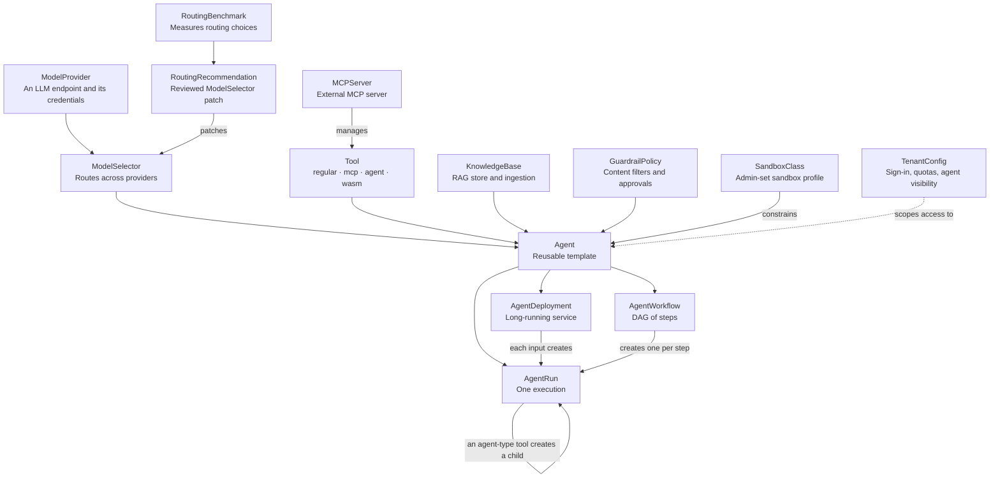
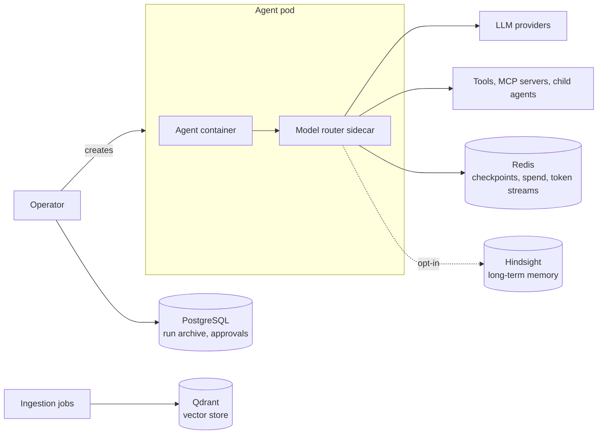

# Architecture

agent-orca is a Kubernetes operator. You describe agents, models and tools as
custom resources, and the operator turns each run into pods.

## How the resources fit together

[CRDs](crds.md) describes every resource and its fields.

## What runs in the cluster

- **Agent container.** Your image, or a reference image. It talks to models
  through the router. [Agent images](agent-images.md) is the contract.
- **Model router sidecar.** The LLM proxy beside each agent. It picks a
  provider, streams tokens, counts spend, compacts context, saves checkpoints
  and runs tool calls.
- **Knowledge bases.** A `KnowledgeBase` deploys Qdrant. Kubernetes Jobs using
  the MCP ingester image extract, chunk and embed documents. See [RAG](rag.md).
- **PostgreSQL.** Stores finished runs and approvals. See
  [Run archival](run-archival.md).
- **Hindsight.** Optional long-term memory, with one bank per agent. See
  [Hindsight authentication](hindsight-auth.md).
- **OpenShell.** When an agent sets `spec.runtime.sandbox`, its process runs in
  an NVIDIA OpenShell sandbox, and the model router stays outside it as the
  path to models. See [OpenShell sandbox](openshell-sandbox.md).

## Operator ports

| Port | Surface | Caller | Authentication |
|------|---------|--------|----------------|
| 8000 | ACP API | ACP clients and editors | OAuth2, federated OIDC or Kubernetes ServiceAccount |
| 8080 | Metrics | Prometheus | Cluster-internal |
| 8081 | Health probes | kubelet | None |
| 8082 | Internal API | Agent pods and model routers | Kubernetes TokenReview |
| 8083 | UI API | The UI proxy | ServiceAccount token or OIDC |
| 8084 | External Task API | Integrations | OAuth2, federated OIDC or Kubernetes ServiceAccount |
| 9443 | Admission webhooks | Kubernetes API server | TLS |

The `agent-orca-internal-api` Service exposes ports 8000, 8082, 8083 and 8084.
Metrics have their own `agent-orca-metrics` Service.

## API surfaces

For production, expose the External Task API, and the ACP API if you need it,
through an Ingress or Gateway. Keep the UI API inside the cluster, behind the
[UI proxy](ui-proxy.md). [Authentication](auth.md) covers each surface.

| To | Use |
|----|-----|
| Submit, poll, stream and cancel tasks | [External Task API](enterprise-integration.md#external-task-api) |
| Discover agents and run them | [ACP API](acp-api.md) |
| Manage tenants | [Admin API](admin-api.md) |
| Do any of this from a terminal | [aoctl](aoctl-reference.md) |

[Integrating with agent-orca](integrating.md) walks through them, and
[OpenAPI spec](openapi-spec.md) has the machine-readable contracts.

### Chat endpoints for deployments

The web UI talks to an `AgentDeployment` through these UI API endpoints, under
`/api/deployments/<namespace>/<name>`. They follow your sign-in settings. For
integrations, use the APIs above.

| Request | What it does |
|---------|--------------|
| `GET` | Deployment status |
| `POST .../execute` | Takes `input` and an optional `sessionId`. Creates an `AgentRun` and returns `runName` and `sessionId` at once, before the agent finishes |
| `POST .../complete` | Saves a run's answer to the session |
| `GET .../history?sessionId=...` | The session's conversation |
| `GET .../stream` | A placeholder that does not stream tokens yet |

## How session state works

agent-orca keeps two kinds of state. Both use Redis.

**Run state** belongs to one run, under keys starting
`agentorca/runs/<run>/state`. The model router saves the conversation
(zstd-compressed, with a TTL), the spend so far, the token and trace stream and
a cancel flag. A restarted or resumed run reloads its conversation and spend, so
a pod crash does not reset them.

**Session state** links the turns of a chat. A checkpoint, keyed by session ID,
holds the conversation history, a version number, cost metadata and the name of
the last run. The next turn in the session loads that run's conversation. This
also works when a warm pod is reused. If no state backend is configured, session
checkpoints are kept in memory and do not survive an operator restart.

A conversation does not grow without limit. When a request would pass 80% of the
selected provider's context window, the router replaces the history with a
structured summary and keeps the original task and the latest message. You can
change the threshold. See [Context management](context-management.md).
