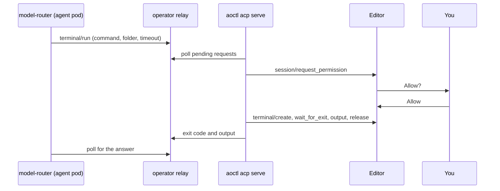

# Local terminal (`local_exec`)

An Agent with `spec.terminal` gets a built-in `local_exec` tool that runs shell
commands **on your own computer**, in your editor's terminal, while you work
with the agent through [`aoctl acp serve`](aoctl-reference.md#aoctl-acp). You
approve every command and watch its output live.

It is not a sandbox. Compare:

| | `local_exec` (`spec.terminal`) | `sandbox_exec` ([`spec.shell`](sandbox-shell.md)) |
|---|---|---|
| Runs on | your computer, as you | an isolated sandbox in the cluster |
| Sees your checkout, tools and accounts | yes | no |
| Confined by | your approval of each command | the SandboxClass policy |
| Works from the UI, chat or schedules | no | yes |

An agent can have both. The tool descriptions tell it to prefer the sandbox for
anything that does not need your machine.

## Enabling it

1. Give the Agent a terminal. `{}` takes the defaults:

   ```yaml
   apiVersion: agentorca.agentorca.io/v1alpha1
   kind: Agent
   metadata:
     name: senior-programmer
   spec:
     # ...
     terminal:
       maxTimeoutSeconds: 600   # longest one command may run (1-1200)
   ```

   With the `agent-orca-resources` chart, set `terminal: {}` on the agent.

2. Install an `aoctl` that includes this feature, and restart the agent in your
   editor so a new bridge starts. The bridge reads the Agent's settings when it
   starts, and logs `local_exec is available` to the editor's agent log.

3. The operator needs the same shared state store (Redis) as
   [filesystem access](filesystem-access.md); without it, commands are refused.

To keep a computer from running any command, whatever the Agent says:

```bash
aoctl acp serve --agent senior-programmer --no-terminal
```

In Zed, add `"--no-terminal"` to the agent server's `args`.

## What you see

Before each command, the editor asks you to allow it. The prompt shows the
whole command, the folder it starts in and how long it may run. You can:

- **Allow** it once.
- **Always allow this exact command here**: the same text in the same folder
  runs without asking until the session ends. Any difference, even a space,
  asks again.
- **Reject** it. The agent is told, and is instructed not to retry or work
  around the refusal.

An approval left unanswered for 5 minutes counts as a refusal. There is no
setting, on the Agent or on `aoctl`, that skips approval.

The command then runs in an editor terminal. Cancelling the turn or reaching the
time limit stops it.

## What the agent can run

- A shell command or short script, up to 4,000 bytes, so that you can read all
  of it before approving.
- It starts in the session's project folder, or in a `work_dir` inside it (or
  inside an `--fs-roots` folder).
- Each call is a new shell: `cd` and exported variables do not carry over.
- There is no input. A command that prompts gets end-of-file.
- Commands that keep running (dev servers, watchers) are stopped at the time
  limit. There is no background mode.
- Zed runs agent commands with `/bin/sh`, not your login shell, so aliases and
  shell functions from your zsh or bash setup are not available.

The agent gets back the exit code, the last 30,000 bytes of combined output,
the folder and the operating system.

## Security

**The approval is the safeguard.** A command runs with your permissions. It can
read, change and send anything you can, and the project folder only decides
where it *starts*. An agent can be misled by text it reads (a web page, a
ticket, a file in the repository), so read each command as if a stranger had
sent it. Take particular care with "always allow" for a command that runs code
from the project, such as `make test` or `npm test`: the command stays the same
while what it runs can change, including through the agent's own file edits.

What the bridge enforces:

| Rule | Detail |
|---|---|
| Every command is asked about | Only your own "always allow" is remembered, for the exact command and folder, in that session |
| Only an explicit allow runs it | A rejection, cancellation, timeout, unrecognised answer or failed prompt refuses |
| What you see is what runs | The editor is given the same string as the prompt shows, with no arguments or environment variables added by the agent. Commands containing control, zero-width or text-reordering characters are refused |
| Each request runs once | A request the relay lists again is ignored |
| Starting folder | Must be inside the workspace, also after resolving symlinks |

What the cluster enforces: the tool exists only for an Agent with
`spec.terminal`, and a command is accepted only on a run that was started (or
resumed) by a bridge whose editor offers a terminal. Runs from the UI, chat
channels, schedules, and runs the agent delegates to are refused at once, with
a message telling the agent why.

**Command output leaves your computer.** It goes to the model provider as part
of the conversation and is stored with the run (its trace and checkpoints), like
any tool result. Do not approve commands that print secrets.

## How it works



It uses the [filesystem relay](filesystem-access.md#architecture) and its
endpoints. `aoctl` tells the server that it can run commands with
`client_capabilities: {"terminal": true}` when it starts or resumes a run.

## Editor support

The editor must offer ACP's terminal capability
(`clientCapabilities.terminal`). If it does not, `local_exec` reports that no
terminal is connected; `aoctl` never runs the command itself.

Developed for Zed. `terminal/*` is part of ACP version 1, which the bridge
speaks. The ACP version 2 preview removes the client terminal methods, so
moving the bridge to version 2 will need another way to run commands.

## Troubleshooting

| The agent reports | Check |
|---|---|
| `no editor terminal is connected to this run` | You are using the agent from the editor, `aoctl` is new enough, `--no-terminal` is not set, and you restarted the agent after adding `spec.terminal`. The editor's agent log says which applies |
| `this agent was not given a local terminal` | `spec.terminal` on the Agent |
| `the editor did not answer in time` | The editor session is still open |
| No `local_exec` tool at all | The operator and model-router are new enough. For a published (warm) agent, the operator replaces its pods after the change |
